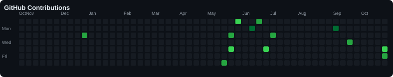
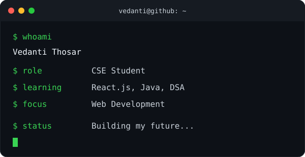

<p align="center">
  <a href="https://git.io/typing-svg">
    
  </a>
</p>

# `vedanti@github:~$ whoami`

```text
╭──────────────────────────────────────────╮
│  Hello, World! 👋                        │
│                                          │
│  Name     : Vedanti Thosar               │
│  Role     : Third Year CSE Student       │
│  Learning : React.js | Java | DSA        │
│  Focus    : Frontend & Web Development   │
│  Status   : Building my future...        │
╰──────────────────────────────────────────╯
```

---

### `$ git log --graph --contributions`

<p align="center">
  
</p>

---

### `$ whoami --visual`

<table>
  <tr>
    <td align="center" width="50%">
      
    </td>
    <td align="center" width="50%">
      
    </td>
  </tr>
</table>

---

### `$ cat about.txt`

Hey! I'm Vedanti, a third-year Computer Science Engineering student passionate about learning, building projects, and growing as a developer.

- 🌱 Currently learning React.js and Java
- 💻 Exploring frontend development and Data Structures & Algorithms
- 🚀 Building projects and learning by doing
- 🎯 Working towards my software developer goals
- ✨ Believing that small steps every day lead to big progress

### `$ ls projects/`

- 🍔 **Zomato Clone** — Exploring food-delivery UI development
- 🌍 **Wanderlust** — A travel listing web development project

### `$ cat currently_learning.txt`

```text
React.js       [Learning]
Java + DSA     [Practicing]
Web Dev        [Building]
Consistency    [Always ON]
```

---

### `$ git stats --profile`

<p align="center">
  
  
</p>


### `$ connect --with vedanti`

<p align="center">
  <a href="https://github.com/Vedanti-0417">
    
  </a>
  <a href="https://www.linkedin.com/in/vedanti-thosar10/">
    
  </a>
</p>

<p align="center">
  <i>Open to learning, collaboration, and new opportunities! 🚀</i>
</p>
---

### `$ echo "Thanks for visiting!"`

<p align="center">
  Thanks for stopping by! 🤍
</p>

<p align="center">
  <i>Keep learning. Keep building. Keep going. ✨</i>
</p>
